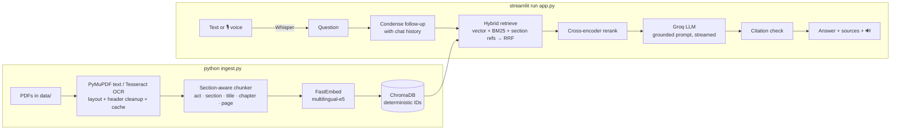

# ⚖️ Bangladesh Legal Aid Chatbot · বাংলাদেশ আইন সহায়তা

[](https://github.com/tonmoyjoy/Bangladesh-Legal-Chatbot/actions/workflows/ci.yml)


A bilingual (**Bangla + English**) retrieval-augmented chatbot that answers questions about
Bangladesh law **with numbered citations to the exact act, section and page**. Ask by
**typing or speaking**; answers can be read back aloud.

> **Live demo:** _add your deployment URL here_ · **Screenshots:** see [`docs/screenshots/`](docs/screenshots/)

Covered statutes (sample corpus): Constitution of Bangladesh · Penal Code, 1860 ·
Code of Criminal Procedure, 1898 · Muslim Family Laws Ordinance, 1961.

> ⚠️ The file `Muslim Family Law ordinance.pdf` shipped with the original project is actually
> *The Engineering and Technological University Ordinance, 1961*. Replace it with the real
> MFLO from <https://bdlaws.minlaw.gov.bd/act-print-305.html> (ingest warns about such mismatches).

---

## ✨ Features

| | |
|---|---|
| 🔎 **Hybrid retrieval** | Multilingual dense vectors (`multilingual-e5`) + BM25 keywords, fused with Reciprocal Rank Fusion, then a cross-encoder reranker (`bge-reranker-v2-m3`). Questions that name a section ("section 302", "ধারা ৩০২", "article 33") pull that section in directly. |
| 📑 **Legal-aware chunking** | One chunk per section/article with act, section, title, chapter, part and page metadata. Each chunk is prefixed with e.g. `Penal Code, 1860 — Section 302: Punishment for murder`. |
| 🖨️ **OCR for scanned PDFs** | Layout-aware Tesseract OCR re-attaches the margin titles of bdlaws print-outs to their sections; removes repeated headers/footers; results cached. |
| ✅ **Checked citations** | The model must cite `[n]`; citations pointing at non-existent sources are removed, and answers without citations are marked *needs verification*. The sources panel shows *exactly* the chunks the model saw. |
| 🔁 **Model failover** | If the selected Groq model is rate-limited, down or retired, the next model in `LLM_MODELS` answers automatically ([details](#-model-failover)). |
| 🛡️ **Corpus integrity** | Ingest refuses PDFs whose printed title contradicts their file name (e.g. a "Muslim Family Law" file that is really a university ordinance) unless you override it; the app warns about such documents. |
| 💬 **Conversation memory** | Follow-ups ("and the punishment?") are rewritten into standalone questions before retrieval. |
| 🎙️ **Voice input + commands** | Record in the chat box → Groq Whisper transcribes Bangla/English. Say *"clear chat"*, *"উত্তর পড়ে শোনাও"* etc. to control the app. Optional read-aloud of answers (browser speech, free). |
| 🔐 **Safe multi-user design** | Per-session API key/model/Top-K (nothing shared between visitors), no raw HTML rendering, XSRF protection on, per-session rate limits, friendly errors. |
| 🧪 **Tested** | 172 pytest tests (unit + Streamlit `AppTest` UI tests), ruff, strict mypy, pip-audit, Docker build + health-check in CI. |

## 🏗️ Architecture



More detail and design decisions: [`docs/architecture.md`](docs/architecture.md).

## 🚀 Quick start

**Requirements:** Python 3.11–3.13, a free [Groq API key](https://console.groq.com/keys),
and [Tesseract OCR](#-install-tesseract-ocr) if your PDFs are scans (the sample PDFs are).

```bash
# 1. Install
python -m venv .venv
.venv\Scripts\activate            # Windows   (macOS/Linux: source .venv/bin/activate)
pip install -r requirements.txt

# 2. Configure
copy .env.example .env            # macOS/Linux: cp .env.example .env
#    then set GROQ_API_KEY in .env (or paste a key in the app sidebar later)

# 3. Put the law PDFs in data/  (see data/README.txt), then build the index
python scripts/download_models.py # optional: pre-download models (~1.5 GB, once)
python ingest.py                  # first run OCRs scanned pages; later runs are fast

# 4. Run
streamlit run app.py
```

The first ingest of the four sample PDFs (565 scanned pages) takes roughly 10–20 minutes on a
laptop (OCR + embedding). Re-running `python ingest.py` only processes what changed.

### 🖨️ Install Tesseract OCR

| OS | Command |
|---|---|
| Windows | Install from [UB-Mannheim/tesseract](https://github.com/UB-Mannheim/tesseract/wiki). In the installer, under *Additional language data*, tick **Bengali**. If `tesseract` isn't on PATH, set `TESSERACT_CMD` in `.env`. |
| Ubuntu/Debian | `sudo apt install tesseract-ocr tesseract-ocr-ben` |
| macOS | `brew install tesseract tesseract-lang` |

If the Bengali pack is missing, OCR still runs in English and logs a warning.

## 🎙️ Voice

* Tap the **microphone in the chat box**, speak, and send. Audio is transcribed by Groq
  Whisper (`whisper-large-v3-turbo`); choose *Auto / বাংলা / English* in the sidebar.
* You can also type text **and** record — both are combined into one question.
* **Commands** (spoken or typed, as the whole message):

  | Action | English | বাংলা |
  |---|---|---|
  | Clear conversation | *clear chat*, *new chat*, *start over* | *চ্যাট মুছে ফেলো*, *নতুন চ্যাট* |
  | Show / hide sources | *show sources* / *hide sources* | *উৎস দেখাও* / *উৎস লুকাও* |
  | Read last answer aloud | *read the answer* | *উত্তর পড়ে শোনাও* |
  | Stop reading | *stop* | *থামো* |

* **Read answers aloud** uses the browser's built-in speech (Chrome/Edge recommended). Bangla
  speech needs a Bangla voice installed on the device (Windows: *Settings → Time & language →
  Speech → Add voices → বাংলা*); otherwise the browser's default voice is used.

## ⚙️ Configuration

All settings live in `.env` (local) or Streamlit secrets (cloud); see [`.env.example`](.env.example).

| Key | Default | Notes |
|---|---|---|
| `GROQ_API_KEY` | – | Server key. Empty → each visitor pastes their own key (session-only). |
| `GROQ_MODEL` / `LLM_MODELS` | `openai/gpt-oss-120b` / `…120b,…20b` | Default model / failover order (comma-separated). One model = failover off. Llama 3.x models were retired from Groq free/dev tiers on 2026-08-16. |
| `EMBEDDING_MODEL` | `intfloat/multilingual-e5-base` | `…-e5-small` for low-memory hosts. Changing it requires `python ingest.py --rebuild`. |
| `RERANKER_MODEL` | `BAAI/bge-reranker-v2-m3-int8` | Empty = no reranker. |
| `CHROMA_MODE` | `local` | `local` (disk), `http` (own server), `cloud` (Chroma Cloud). |
| `TOP_K` / `CANDIDATE_K` | 5 / 20 | Sources per answer / candidates before reranking. |
| `RATE_LIMIT_PER_MINUTE` | 8 | Questions per visitor per minute. |
| `OCR_LANG` | `eng+ben` | A missing `ben` pack is reported by ingest and diagnostics (English OCR still runs). |
| `ALLOW_SUSPICIOUS_DOCS` | `false` | `true` = index PDFs whose title contradicts the file name (same as `ingest.py --allow-suspicious`). |

Check your setup at any time with `python -m legalbot.diagnostics` — it names each missing piece
(PDFs, index, Groq key, Tesseract, Bengali OCR data, embedding-model mismatch) and the exact fix.
The app shows the same messages instead of a chat box when something blocking is missing.

## 🔁 Model failover

`LLM_MODELS=openai/gpt-oss-120b,openai/gpt-oss-20b` defines the fallback order.

* **Order:** the model selected in the sidebar first, then the other configured models in order.
  Retired models are skipped; a model that answers *not found / disabled* is skipped for the
  rest of that visitor's session (other visitors are unaffected).
* **Switches to the next model on:** rate limits (429, and 413 "request too large for this
  model's per-minute budget"), timeouts, connection errors, provider errors (5xx, 498), and
  model not found / disabled / decommissioned. The switch is immediate; only the last remaining
  model is retried with a short backoff.
* **Never retried:** invalid API key, malformed requests, empty or too-long questions (> 2,000
  characters), configuration errors, and unexpected internal errors.
* **While streaming:** if a model fails *before* its first word, the next model answers and
  the user only sees a small notice. If it fails *after* text has appeared, the partial text
  stays on screen, clearly marked as interrupted / needs verification, with a
  **🔁 Retry with ‹next model›** button that re-asks the same question — a second answer is
  never glued onto a partial one. Citation checks run on partial and retried answers.
* **What the user sees:** *"The selected model is unavailable. Trying the next configured
  model…"* and, after a fallback, *"Answered using openai/gpt-oss-20b."* The sidebar selection is
  not changed and nothing is changed for other users.
* **Disable failover:** configure a single model, e.g. `LLM_MODELS=openai/gpt-oss-120b`
  (transient errors are then retried on that model with backoff).
* **Limits:** all default models share one Groq account, so failover does not help when Groq
  itself is down or the whole account is rate-limited. Failover improves availability only —
  it does **not** make an answer more legally correct. Logs record model names, failure
  categories and attempt counts, never API keys, questions or answers.

## 🧱 Ingestion

```bash
python ingest.py             # incremental: upsert new/changed chunks, delete stale ones
python ingest.py --rebuild   # wipe and rebuild (needed after changing EMBEDDING_MODEL)
python ingest.py --dry-run   # parse + chunk only and print per-act statistics
python ingest.py --allow-suspicious   # index PDFs whose title contradicts the file name
```

Ingest stops (exit code 3, nothing written) when a PDF's file name names a known statute but the
title printed in the document is a different act. Replace the file, or override with
`--allow-suspicious` / `ALLOW_SUSPICIOUS_DOCS=true` — the app then shows a warning banner and marks
those sources. If scanned PDFs are present and Tesseract is missing, ingest stops with the
install command instead of silently skipping pages.

Chunk IDs are deterministic (hash of source + position + text), so re-running never creates
duplicates. OCR output is cached in `.cache/ocr/`.

## 📊 Evaluation

`evals/dataset.jsonl` holds 31 questions (28 with known act + section, incl. Bangla; 3
out-of-scope that must be refused).

```bash
python -m evals.run_evals                     # retrieval: hit@5, MRR (no API key needed)
python -m evals.run_evals --answers --judge   # + keyword recall, citation validity,
                                              #   refusal accuracy, LLM-judged faithfulness
```

Measured so far on the real, OCR'd corpus (Constitution, Penal Code, CrPC; the 4 MFLO
questions are excluded until the correct PDF is added):

| Metric | Value |
|---|---|
| Retrieval hit@5 — keyword baseline (BM25 + section pinning, no embeddings), 24 questions incl. Bangla | **1.00** |
| Retrieval MRR — keyword baseline | **0.858** |
| Retrieval hit@5 / MRR — full hybrid + reranker | _run `python -m evals.run_evals`_ |
| Keyword recall · citation validity · refusal accuracy · faithfulness | _run with `--answers --judge`_ |

`python -m evals.run_evals --bm25-only` reproduces the baseline without downloading any model.
Full results are written to `evals/results.md`.

## 🧪 Development

```bash
pip install -r requirements-dev.txt
pytest --cov            # unit + Streamlit AppTest UI tests (no network, no model downloads)
ruff check . && ruff format --check .
mypy                    # strict
pip-audit -r requirements.txt
```

Dependencies are locked in `requirements.txt` (generated from `requirements.in` with
`uv pip compile requirements.in --universal --python-version 3.11 -o requirements.txt`).

## ☁️ Deployment

**Docker (recommended):**

```bash
docker compose up --build      # http://localhost:8501
```

`./data` is mounted read-only; the index is built automatically on first start and kept in a
named volume. Models are baked into the image at build time. Health check:
`GET /_stcore/health`.

**Streamlit Community Cloud:** memory is limited, so use `EMBEDDING_MODEL=intfloat/multilingual-e5-small`
and `RERANKER_MODEL=` (empty). Build the index **locally** into
[Chroma Cloud](https://trychroma.com) (`CHROMA_MODE=cloud` + credentials, then `python ingest.py`),
and put the same settings in the app's *Secrets* (see `.streamlit/secrets.toml.example`).
Never commit the vector index or PDFs to git.

## 📁 Project structure

```
app.py                  Streamlit UI (chat, voice, sidebar, sources)
ingest.py               CLI: PDFs → chunks → embeddings → ChromaDB
legalbot/
  config.py             immutable settings (env / secrets / defaults)
  pdf_loader.py         PyMuPDF + layout-aware OCR + header/footer removal + cache
  chunker.py            section/article-aware chunking with metadata
  embeddings.py         FastEmbed (default) or sentence-transformers
  vectorstore.py        Chroma wrapper (local / http / cloud), upsert, stale cleanup
  retrieval.py          hybrid retrieval, RRF, section-reference pinning, reranker
  rag.py                condense → retrieve once → stream answer → finalize
  citations.py          [n] validation
  llm.py                Groq client factory, error classification, model failover, friendly errors
  diagnostics.py        setup checks with exact fix commands (app, ingest, CLI)
  voice.py              Whisper transcription, voice commands, text-to-speech
  ratelimit.py          per-session sliding-window limiter
  services.py           builds the shared (cached) backend
evals/                  dataset + evaluation runner
tests/                  pytest suite (fixtures generate PDFs; no network)
scripts/                model download, index check, Docker entrypoint
```

## ⚠️ Limitations

* General legal **information**, not legal advice. Laws change — answers reflect the PDFs you ingest.
* OCR quality depends on scan quality; footnote markers and amendments can be misread.
* Groq's free tier has rate limits; heavy public use needs a paid key or per-user keys.
* Model failover only covers models on the same Groq account; it is not a legal-accuracy check.

## 📄 License

MIT — see [LICENSE](LICENSE). Statute texts are public law from the
[Laws of Bangladesh](https://bdlaws.minlaw.gov.bd) portal and are not redistributed in this repo.
