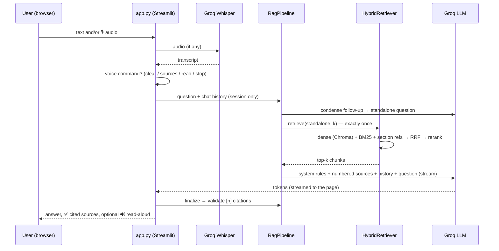

# Architecture & design decisions

## Request flow



## Model failover (`legalbot/llm.py`)

```mermaid
flowchart TD
  S[selected model] --> A{call / stream}
  A -->|ok| OK[answer · "Answered using X" if not the selected model]
  A -->|rate limit · timeout · connection · 5xx · model gone| N{tokens already shown?}
  N -->|no| NX{another model left?}
  NX -->|yes| A2[next model in LLM_MODELS] --> A
  NX -->|no, last model| B[backoff retry same model ×2] --> F[AllModelsFailedError → friendly message]
  N -->|yes| P[PartialStreamError → keep text, mark incomplete, offer 'Retry with next model']
  A -->|invalid key · bad request · invalid input · config · unknown| X[raise immediately — no retry]
```

* One implementation (`ModelFailover`) serves both LLM calls of a question — the follow-up
  rewrite (`invoke`) and the answer (`stream`). After a fallback, the answer stream starts at
  the model that worked instead of re-trying the failed one.
* `rag.py` accepts either a plain chat model (wrapped in `SingleModelRunner`, the v2.0
  same-model retry behaviour) or a runner, so the pipeline, evals and tests stay simple.
* Per-session state: the set of models found unavailable lives in `st.session_state`.
* Failover improves availability, not correctness: the same grounding prompt, citation
  validation and "needs verification" marking apply to every model's answer.

## Setup diagnostics (`legalbot/diagnostics.py`)

`index_diagnostics`, `api_key_diagnostics` and `ocr_diagnostics` return `Diagnostic(code,
severity, message, fix)` objects. The app renders blocking ones instead of the chat box,
`ingest.py` stops on blocking OCR problems, and `python -m legalbot.diagnostics` prints them all.
Codes: `missing_pdfs`, `missing_index`, `missing_api_key`, `missing_tesseract`,
`missing_bengali_ocr`, `incompatible_embedding_model`, `index_unavailable`.

## Key decisions

| Decision | Why |
|---|---|
| **Immutable `Settings` + per-session state** | The old app mutated a module-level `cfg`, so one visitor's API key/model leaked to everyone on a shared server. Now only stateless, secret-free resources (models, index) are cached with `st.cache_resource`; the LLM client is built per request with the session's key. |
| **Retrieve once** | The old code searched twice (once for the UI, once inside the chain), doubling latency and sometimes showing different sources than the model used. |
| **FastEmbed (ONNX) instead of PyTorch** | ~10× smaller install, CPU-fast, fits Streamlit Cloud. `sentence-transformers` remains available via `EMBEDDING_BACKEND`. |
| **`multilingual-e5-base`** | `all-MiniLM-L6-v2` is English-only; e5 handles Bangla questions against English statutes and vice versa. MIT licence. |
| **Hybrid search + RRF** | Legal questions often hinge on exact terms ("bail", "non-bailable", section numbers) where BM25 beats vectors; vectors handle paraphrase and Bangla. RRF needs no score calibration. |
| **Section-reference pinning** | "Section 302" / "ধারা ৩০২" / "article 33" deterministically retrieve that provision (filtered by act when the question names one). |
| **`bge-reranker-v2-m3` (int8)** | Multilingual, Apache-2.0 (commercial use OK — Jina v2 is CC-BY-NC), ~570 MB. Optional. |
| **Section-level chunks with header prefix** | The header (`Penal Code, 1860 — Section 302: Punishment for murder`) is embedded with the text, which improves both retrieval and citation quality. |
| **Chain-DP heading detection** | Numbered lists inside sections, tables of contents and OCR errors ("24[33." read as "24733.") produce false headings. A dynamic program keeps the highest-scoring plausible sequence of section numbers. |
| **Layout-aware OCR** | bdlaws print-outs put section titles in a margin column. Plain Tesseract output lists all margin notes at the top of the page; we rebuild lines from word boxes and re-attach each note above its section. Raw OCR boxes are cached, so layout logic can change without re-OCR. |
| **Deterministic chunk IDs + stale cleanup** | Re-running ingest upserts; chunks from an edited PDF that no longer exist are deleted. `--rebuild` wipes everything. |
| **Embedding model stored on the collection** | Querying an index built with another model fails loudly instead of returning nonsense. |
| **Citation validation** | `[n]` markers outside `1..k` are stripped and the user is warned; uncited answers are flagged. |
| **Browser speech for read-aloud** | Free, private (no audio leaves the device), works offline; Bangla depends on an installed voice. |

## Measured on the real corpus (offline)

The four PDFs supplied with the original project are all **image-only scans** (565 pages).
With Tesseract 5 (English pack, 2 CPU workers) the full OCR took ~9 minutes; re-runs use the
cache (~15 s for the whole pipeline).

| Document | Chunks | Distinct sections/articles found | Notes |
|---|---|---|---|
| Constitution of Bangladesh | 227 | 151 articles, every one with its margin title | e.g. *Article 33: Safeguards as to arrest and detention* |
| Penal Code, 1860 | 709 | 533 (incl. lettered sections like 171E, 304A) | only 4 numbers of 1–511 not found |
| Code of Criminal Procedure, 1898 | 794 | 449 | gaps are mostly provisions omitted in Bangladesh (e.g. 206–220, 266–336, 488–490) |
| "Muslim Family Law ordinance.pdf" | 52 | 36 | **wrong document** — it is the Engineering and Technological University Ordinance, 1961 |

Keyword-only retrieval baseline (BM25 + section pinning, no embeddings), 24 in-scope
questions: **hit@5 = 1.00, MRR = 0.858**. Bangla questions such as
*দণ্ডবিধির ৩০২ ধারায় খুনের শাস্তি কী?* resolve to Penal Code s. 302 at rank 1.

The loader reads the title printed in each PDF; when it contradicts the file name the document
is marked *suspicious*, `ingest.py` refuses to index it (exit 3) unless `--allow-suspicious` is
given, and the app shows a warning banner (also for indexes built before this check). Replace the
mislabelled file with the real MFLO
(<https://bdlaws.minlaw.gov.bd/act-print-305.html>).

## Extending

* **New act:** drop the PDF in `data/`, run `python ingest.py`. Optionally add a pretty name
  in `legalbot/chunker.py::_KNOWN_ACTS` and a hint in `legalbot/retrieval.py::_ACT_HINTS`.
* **Another LLM provider:** implement a `BaseChatModel` factory like `llm.build_chat_model`;
  the pipeline only depends on LangChain's chat-model interface.
* **Another vector DB:** implement `similarity_search(query, k)` and `all_documents()`.
